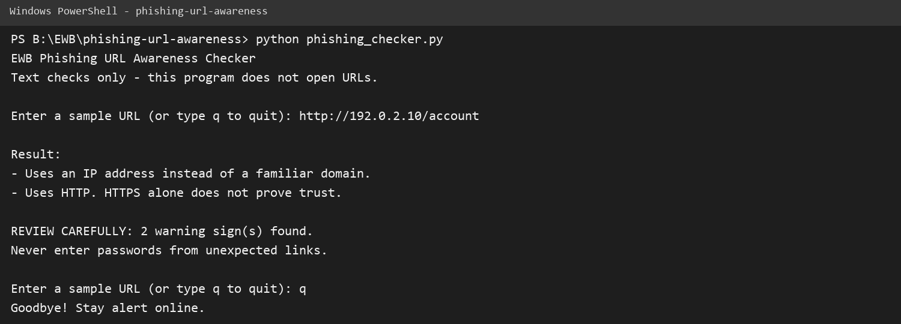
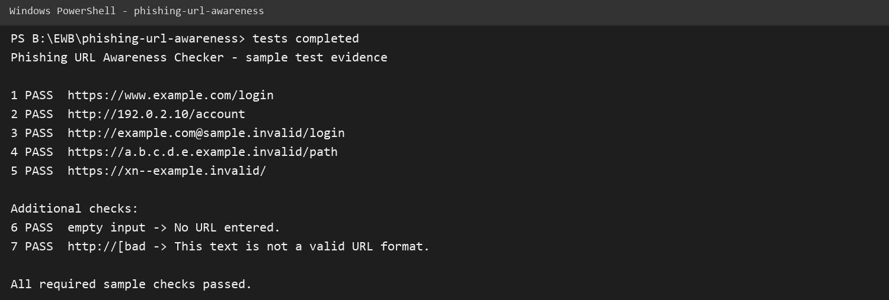

# EWB Phishing URL Awareness Checker

## Overview

Phishing is a trick that uses a fake message or link to make someone reveal
information such as a password or payment detail. This educational command-line
tool reads a URL as plain text and highlights six visible warning signs without
opening the URL or sending data anywhere.

## Features

- Detects an `@` symbol in the URL
- Flags unusually long URLs (over 100 characters)
- Flags IP-address hostnames
- Flags many hostname segments (5 or more)
- Flags punycode-style hostnames (`xn--`)
- Flags the HTTP scheme
- Repeats checks until the user enters `q`, `quit`, or `exit`
- Handles malformed URL text without crashing
- Prints a cautious review message when warning signs are found

## Requirements

Python 3.10 or later. No extra packages are required.

## How to Run

From this directory, run:

```text
Windows:   python phishing_checker.py
Mac/Linux: python3 phishing_checker.py
```

The program asks for sample URL text. Enter `q` to quit. Use only safe sample
strings; do not enter passwords or real suspicious links.

## Example Output

```text
EWB Phishing URL Awareness Checker
Text checks only - this program does not open URLs.

Enter a sample URL (or type q to quit): http://192.0.2.10/account

Result:
- Uses an IP address instead of a familiar domain.
- Uses HTTP. HTTPS alone does not prove trust.

REVIEW CAREFULLY: 2 warning sign(s) found.
Never enter passwords from unexpected links.
```

## Testing

The five required sample results and two extra safety checks are recorded in
[tests/test_samples.md](tests/test_samples.md).

## Screenshots




## Improvements

1. **Repeatable input:** the program checks multiple samples in one run and
   exits with a clear quit command.
2. **Safe malformed-input handling:** invalid URL text such as `http://[bad`
   produces a clear message instead of a traceback.
3. **Review summary:** warning results include a count so the user knows when
   to review the link carefully.

## Limitations

This is an educational tool. It only reads URL text. It does not visit URLs,
scan for malware, query reputation services, or prove that a URL is safe.
No warning signs found does **not** mean a URL is safe.

## Ethical Use

Use the reserved sample strings in the test table. Do not collect credentials,
send phishing messages, scan websites, or test systems without permission.

## Author

EWB Courses learner
